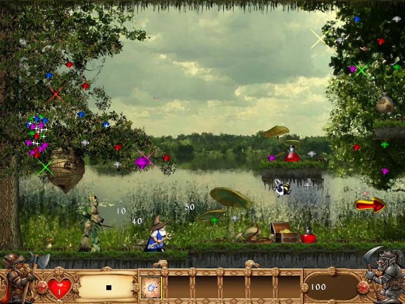

# Vaprad Päkapikud (Brave Dwarves 2) in the browser



*Brave Dwarves 2 Gold* (2003) was one of my favourite childhood games. I played the Estonian edition, *Vaprad Päkapikud*. This is a port that runs in any modern browser, on a computer or a phone, with nothing to install.

## The experiment

Can an AI bring back an old Windows game using only the game's own files? I gave Claude (Anthropic's AI) the original install folder and asked for a version I could play in a browser. In one conversation, it:

- decompiled `BraveDwarves2.exe` with the [angr](https://angr.io) binary analysis framework to work out how the game behaves: physics, monster AI, weapons, lighting, the shop, the slot machine and saving
- rewrote the engine from scratch in plain JavaScript and Canvas, with no frameworks
- converted the original sprites, sounds, music and levels into formats browsers can use

All 8 episodes are playable, and saves and high scores are kept in the browser.

## Play

```
python3 play.py
```

This starts a small local server and opens the game. Any static web server works; opening `index.html` straight from disk doesn't.

**Controls:** arrow keys to move, Space to jump, Ctrl or X to fire, Z to switch weapons, Tab or M for the map, Esc for the menu. Gamepads also work. On phones, on-screen buttons appear.

## Note

The original graphics, sounds, music and levels belong to their rights holders. This is a non-commercial fan project.
